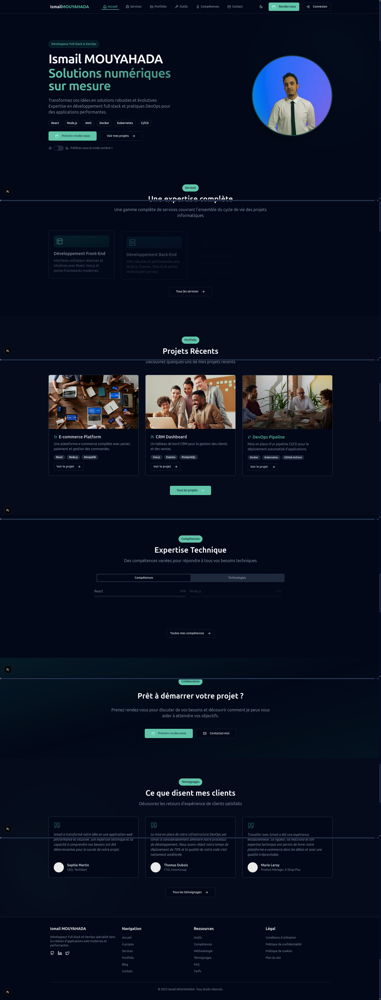

# Ismail MOUYAHADA - Solutions Numériques Sur Mesure




Welcome to the personal portfolio website of **Ismail MOUYAHADA**, a professional offering tailor-made digital solutions with expertise in full-stack development and DevOps practices. This website showcases my skills, services, and recent projects, demonstrating my ability to build high-performance applications using the latest technologies.

## Overview

As a full-stack developer and DevOps engineer, I focus on delivering scalable and efficient solutions. This website presents my technical expertise, recent projects, and the services I offer. It also includes client testimonials and detailed information about my skill set and development tools.

## Features

- **Personal Profile**: An introduction to my professional journey and expertise.
- **Services Offered**: A list of services covering front-end and back-end development, DevOps, and cloud architecture.
- **Portfolio**: Showcasing recent projects that I have worked on, such as e-commerce platforms, CRM dashboards, and DevOps pipelines.
- **Technical Expertise**: A breakdown of my skills and technologies, including React, Node.js, Docker, Kubernetes, AWS, and more.
- **Client Testimonials**: Positive feedback from clients describing their experiences working with me.
- **Contact & Collaboration**: A section for potential clients to schedule a consultation and discuss their projects.

## Technologies

- **Frontend**:
  - React.js
  - Tailwind CSS
  - Vite (for fast builds and optimization)
- **Backend**:
  - Node.js
  - Express.js
  - PostgreSQL, MongoDB (for database management)
  - AWS, Docker, Kubernetes (for cloud and container management)
- **DevOps**:
  - CI/CD Pipelines (GitHub Actions, Jenkins)
  - Docker
  - Kubernetes
  - Terraform (optional, if used for infrastructure provisioning)
- **Others**:
  - Git & GitHub for version control
  - Cloud-based services (AWS, Azure, etc.)

## Installation

Le projet est maintenant structuré en **Monorepo** pour une séparation claire des responsabilités.

### 1. Développement Local (Frontend)
```bash
cd frontend
npm install
npm run dev
```
L'application sera accessible sur `http://localhost:3000`.

### 2. Stack Complète (Docker)
Depuis la racine du projet :
```bash
docker compose up -d
```
Ceci lance l'application Next.js (`localhost:3000`) et la stack Supabase complète (`localhost:8001`).

## 🏗️ Structure du Monorepo

| Dossier | Contenu |
|---------|---------|
| `frontend/` | Application Next.js (App Router, Tailwind, TypeScript) |
| `backend/` | Infrastructure Supabase (Postgres, Kong, etc.) |
| `infra/` | **Infrastructure as Code (IaC)** : Terraform (AWS) et Kubernetes (K8s) |
| `monitoring/` | Configuration Prometheus et Healthchecks |
| `docs/` | Documentation du projet |
| `.github/workflows/` | **CI/CD DevSecOps** : Tests, Scans de sécurité (SAST), Build et Deploy |

Index de la documentation : [`docs/README.md`](docs/README.md).


Index de la documentation : [`docs/README.md`](docs/README.md).

## Configuration

- **Environment Variables**: Set up any necessary environment variables (e.g., API keys for external services) in the `.env` file.

- **Vite Configuration**: Adjust the Vite configuration for production builds if necessary.

## Portfolio Highlights

Here are some examples of the projects I have worked on:

- **E-commerce Platform**: A complete platform with a shopping cart, payment processing, and order management system built using React and MongoDB.
- **CRM Dashboard**: A dashboard for client and sales management built with Node.js, Express, and PostgreSQL.
- **DevOps Pipeline**: A fully automated CI/CD pipeline for deploying applications using Docker and Kubernetes.

## Testimonials

> *"Ismail transformed our idea into a fully functioning web application in record time. His expertise in full-stack development is unparalleled."*
> — **Sophie Martin**, CEO of Textariat

> *"Ismail set up our DevOps pipeline, making our deployment process seamless and efficient. We saw a significant improvement in delivery times."*
> — **Thomas Dubois**, CTO of MimicCorp

> *"Working with Ismail was a fantastic experience. His technical knowledge and communication skills ensured the project met all our objectives."*
> — **Marie Leroy**, Product Manager at E-Shop Plus

## Contributing

If you'd like to contribute to the project, feel free to fork the repository and submit pull requests with bug fixes or improvements.

## License

Distributed under the MIT License. See `LICENSE` for more information.

## Contact

For collaboration inquiries, feel free to reach out through the contact form on the website or email me at [your-email@example.com](mailto:your-email@example.com).

## Footer

```
© 2025 Ismail MOUYAHADA. All rights reserved.
```
